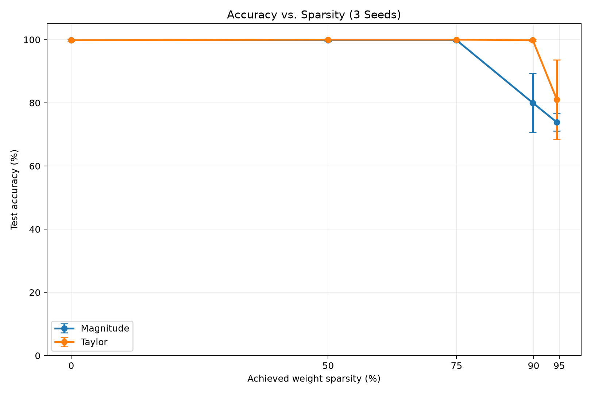

# AQUA Platform: The Self-Pruning Network

A lightweight neural network framework implemented from scratch using Python and NumPy, featuring automatic differentiation, Adam optimization, gradual global pruning, and sparse-aware inference.

The project investigates whether neural connections can be progressively removed during training while preserving classification performance.

## Live Interactive Dashboard

**[Launch AQUA Observatory - Interactive Demo](https://abhinav322.github.io/aqua-self-pruning-network/)**

Explore the self-pruning neural network through an interactive dashboard built from actual recorded experiments.

The dashboard includes:

- Interactive network connectivity and pruning-mask visualization
- Training replay across 200 recorded epochs
- Magnitude versus Taylor pruning comparisons across multiple seeds
- Accuracy, sparsity, and connection-survival metrics
- Inference efficiency benchmarks covering arithmetic reduction, memory usage, and measured latency

The dashboard displays recorded experimental results rather than performing live model training.

## Features

- Custom reverse-mode automatic differentiation engine
- Broadcasting-aware gradients and numerical gradient tests
- Stable softmax cross-entropy
- Multilayer perceptron with ReLU activations
- Adam optimizer implemented from scratch
- Binary weight masks with optimizer-state synchronization and per-connection Adam bias correction
- Global magnitude and Taylor-sensitivity pruning
- Cubic gradual pruning schedule
- Reproducible multi-seed experiments
- Dense and sparse-aware inference implementations
- Accuracy, arithmetic cost, memory, and latency measurements

The neural network training implementation uses NumPy rather than PyTorch or TensorFlow.

## Model Architecture

The classifier uses a two-layer MLP:

Input (2) -> Linear (32) -> ReLU -> Linear (2) -> Class logits

The network contains:

- 128 trainable weights
- 34 trainable biases
- 162 trainable parameters in total

Weight sparsity is measured over the 128 weights, excluding biases.

## Installation

Tested during development with Python 3.12.

Clone the repository and create a virtual environment:

```bash
python -m venv .venv
```

Activate the environment.

Windows PowerShell:

```powershell
.\.venv\Scripts\Activate.ps1
```

Linux/macOS:

```bash
source .venv/bin/activate
```

Install dependencies:

```bash
python -m pip install -r requirements.txt
```

## Run the Tests

```bash
python -m pytest tests/ -q
```

The development test suite contains 75 tests covering autodiff, loss functions, optimizer behavior, pruning, and sparse inference.

The suite also includes checkpoint-dependent tests using trained models saved under `results/sweep_full_v1/`.

## Train a Dense Baseline

```bash
python -m train.run_baseline
```

Outputs are saved under:

`results/baseline/`

This introductory baseline uses a different training split from the main pruning experiments. Use the 0% configurations in the full sweep for direct comparison against pruned models.

## Train a Pruned Network

The following example runs Taylor pruning with seed 42 and a target sparsity of 75%.

Windows PowerShell:

```powershell
$env:AQUA_SEED = "42"
$env:AQUA_METHOD = "taylor"
$env:AQUA_TARGET_SPARSITY = "0.75"

python -m train.run_pruned
```

Other supported importance methods:

- `magnitude`
- `taylor`

After running, clear the environment overrides:

```powershell
Remove-Item Env:AQUA_SEED
Remove-Item Env:AQUA_METHOD
Remove-Item Env:AQUA_TARGET_SPARSITY
```

The experiment saves its training history, model weights, masks, figures, and JSON summary.

## Reproduce the Full Experimental Sweep

The full experiment uses three random seeds:

- 42
- 123
- 2026

Target sparsities:

- 0%
- 50%
- 75%
- 90%
- 95%

At 0%, one dense reference is run per seed.

At nonzero sparsity, both magnitude and Taylor pruning are evaluated.

This produces 27 training runs.

Windows PowerShell:

```powershell
$env:AQUA_SWEEP_ROOT = "results/sweep_full_v1"

python -m train.run_sweep --full

Remove-Item Env:AQUA_SWEEP_ROOT
```

To perform a three-experiment smoke test:

```bash
python -m train.run_sweep --smoke
```

The full sweep writes:

`results/sweep_full_v1/all_results.csv`

## Analyze Accuracy vs. Sparsity

```bash
python -m train.analyze_sweep
```

Outputs:

- `results/sweep_full_v1/aggregated_results.csv`
- `results/sweep_full_v1/accuracy_sparsity.png`

### Main Experimental Results

Mean test accuracy and sample standard deviation across three seeds:

| Target sparsity | Magnitude | Taylor |
|---|---|---|
| 0% | 99.83% ± 0.29% | Shared dense reference |
| 50% | 99.83% ± 0.29% | 100.00% ± 0.00% |
| 75% | 99.83% ± 0.29% | 100.00% ± 0.00% |
| 90% | 80.00% ± 9.37% | 99.83% ± 0.29% |
| 95% | 73.83% ± 2.75% | 81.00% ± 12.58% |

At the 90% target, the implementation achieves 89.84375% weight sparsity because pruning counts are rounded down to whole connections.

Taylor pruning outperformed magnitude pruning substantially at that sparsity level in this synthetic task.

However, performance at 95% sparsity was more variable. These results are not evidence that Taylor pruning is universally superior.



## Benchmark Inference

Run the latency benchmark:

```bash
python -m train.benchmark_inference
```

Generate the consolidated cost report:

```bash
python -m train.analyze_costs
```

Outputs include:

- `inference_benchmark.csv`
- `inference_benchmark_initial.csv`
- `cost_summary.csv`

All are located under `results/sweep_full_v1/`.

### Computational Cost Findings

At 89.84375% weight sparsity:

- Active weights: 13 out of 128
- Weight-related multiplication reduction: 89.84%
- Numerical array-payload storage reduction: 62.96%

Despite the reduced arithmetic, the sparse-aware Python/NumPy implementation was slower than optimized dense inference in all 24 measured comparisons.

The sparse representation uses per-output connection lists, which introduce indexing, Python-loop, and small-operation overhead.

Accordingly, the project demonstrates reduced weight arithmetic and numerical array storage, not a runtime acceleration on the benchmarked hardware.

Memory measurements exclude Python object overhead and temporary allocations.

## Pruning Methodology

Magnitude importance:

`importance = abs(weight)`

First-order Taylor sensitivity:

`importance = abs(weight * gradient)`

Taylor importance is averaged across training batches before pruning decisions.

The implementation uses a cubic schedule with a warmup and recovery phase.

Pruning is monotonic; removed connections are not regrown.

All pruning occurs between forward/backward training steps, and Adam masks and optimizer states are synchronized.

## Repository Structure

```text
engine/    Autodiff engine and loss functions
nn/        Neural network layers, optimizer, sparse inference
prune/     Importance scoring, controller, schedule
train/     Dataset generation, training, sweeps, benchmarks
tests/     Unit tests and integration tests
results/   Experimental artifacts and figures
```

## Limitations

- Experiments use a small synthetic two-moons dataset.
- Only three seeds were evaluated.
- Seeds affect data generation, splitting, and initialization.
- The first-order Taylor approximation may be inaccurate near stationary points or under large pruning changes.
- Unstructured sparsity reduces arithmetic but does not guarantee faster execution.
- Sparse storage calculations exclude Python object overhead.
- The implementation does not support weight regrowth.
- The test set has been inspected during development, so reported results should be interpreted as exploratory experimental evidence.

See `DESIGN.md` for the mathematical derivations, implementation choices, correctness considerations, and further discussion.
